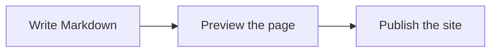

#> Guide

# Content Authoring

## Writing documentation in Markdown

All documentation is written in Markdown, a lightweight markup language that's easy to learn and use.

Each page in your documentation is a Markdown file with optional frontmatter for configuration.

### Basic syntax

Markdown supports all the formatting you need:

- Headings with # symbols
- Bold and italic text
- Lists (ordered and unordered)
- Links and images
- Code blocks

### Frontmatter

At the top of each file, you can include YAML frontmatter to configure the page:

- type: The component to use for rendering
- title: Override the page title
- description: Page description for SEO

### Diagrams

A code block in the `mermaid` language is drawn as a diagram, in the colors of the section around it:

The same block shows as readable text in a plain Markdown viewer that doesn't draw it.

### Best practices

Write clear, concise documentation that helps users accomplish their goals. Use headings to organize content and code examples to illustrate concepts.

Next, learn about [Components](page:components) to customize your pages.
